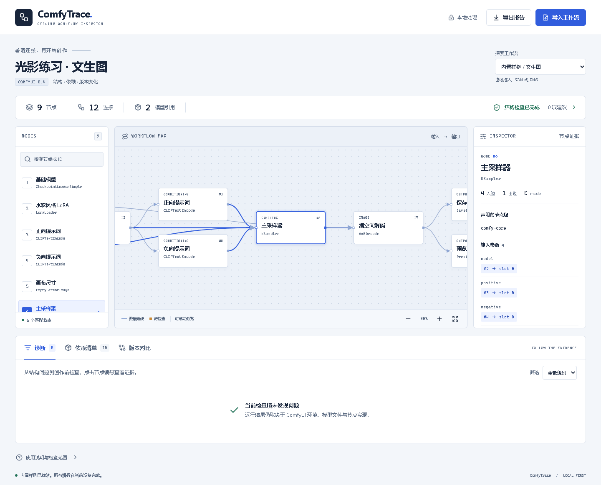

# ComfyTrace

**An offline inspection desk for ComfyUI workflows.**

[Open the demo](https://unknowlei.github.io/comfytrace/) · [Download the portable app](https://github.com/unknowlei/comfytrace/releases/latest) · [CI](https://github.com/unknowlei/comfytrace/actions/workflows/ci.yml)

[中文说明](README.zh-CN.md) · [Architecture](docs/ARCHITECTURE.md) · [Examples](examples/README.md) · [Portfolio notes](docs/PORTFOLIO.zh-CN.md)



ComfyUI workflows are programs disguised as pictures. ComfyTrace makes them
inspectable: trace connections, identify broken references, inventory models and
node types, and understand what changed between revisions without canvas noise.

No ComfyUI server, GPU, account, API key, or installation is required to use the
portable app. Processing happens in your browser; imported files are not uploaded.

## Open and explore

Open **`ComfyTrace.html`** from the portable release in a modern browser. The app
starts with an original sample, so every feature can be explored immediately.

1. Import a ComfyUI UI JSON, API prompt JSON, or PNG containing workflow metadata.
2. Select a node to inspect its parameters and relationships.
3. Review structural diagnostics and model/node dependencies.
4. Import a second revision to see semantic changes with before/after evidence.
5. Export a Markdown report or a JSON dependency manifest.

The interface is currently Chinese; technical identifiers remain unchanged.
An English interface is not currently included.

The hosted demo runs the same local-only application. For fully disconnected
use, download the portable HTML. [Revision comparison screenshot](docs/comparison.png).

## What is implemented

| Capability | Details |
| --- | --- |
| Workflow import | UI 0.4 tuple links, UI 1.0 object links, API prompts and `{ prompt: ... }` request wrappers |
| PNG metadata | tEXt, zTXt, iTXt (plain/deflate), ComfyUI APNG comf chunks; CRC and size bounds |
| Graph inspection | Auto-layout, node selection, search, zoom, readable parameter evidence |
| Static diagnostics | Broken references, duplicate/invalid links, cycles, port consistency and coverage notices |
| Dependencies | Known loader fields and declared model metadata; node-type presence in an optional offline `/object_info` snapshot |
| Semantic comparison | Stable node-ID matching; parameters, node types, modes, wiring and conservative `properties` comparison; ignores canvas movement |
| Portable exports | Escaped Markdown report and versioned JSON dependency manifest |
| Automation | Read-only CLI with machine-readable output and meaningful exit codes |
| Delivery | Single self-contained HTML with all scripts/styles inline and no external fonts |

## Development

Requires Node.js **22.12+** and npm.

```powershell
$ErrorActionPreference = 'Stop'
npm ci
npm run dev
```

Build the standalone page with `npm run build`. It is written to `dist/index.html`.
Use `npm run package` to assemble the portable release, licenses and SHA-256 digest.

### Checks

```powershell
$ErrorActionPreference = 'Stop'
npm run typecheck
npm test
npm run build
npx playwright install chromium
npm run test:e2e
```

Browser tests load the **built file over `file://`**, not a development-server
substitute. On Windows, `PLAYWRIGHT_CHANNEL=msedge` can select installed Edge.

### CLI

```powershell
$ErrorActionPreference = 'Stop'
npm run inspect -- examples/platform-workflow.json
npm run inspect -- examples/platform-workflow.json --compare examples/platform-revision.json --format json
npm run inspect -- examples/api-prompt.json --inventory examples/object-info.json --out report.md
```

For clean JSON on stdout, use `npx tsx src/cli.ts <file> --format json` (npm prints
its own script header). Exit codes: **0** below threshold, **1** diagnostic
threshold met, **2** invalid input or incomparable formats. `--fail-on` accepts
`error` (default), `warning`, or `none`. Existing output files are never overwritten.

## Privacy and scope

- No telemetry, remote fonts, external fetches, persistence or server integration.
- Original files are read-only; page state is discarded when the page closes.
- Reports can contain prompts, model names and paths. Inspect before sharing.
- An inventory verifies node-type presence in that snapshot, not a live installation.
  Model availability always remains unknown; arbitrary custom loader dependencies
  are not inferred. Known UI-only helpers are excluded from backend-node inventory.
- JSON is bounded at 8 MiB; PNG at 50 MiB and expanded metadata at 8 MiB.
- Graphs are bounded to 2,000 nodes / 10,000 links. Large graphs may use a reduced
  visual representation while the bounded static analysis still covers the graph.
- Subgraph instances are retained as outer graph endpoints. Their internal nodes,
  connections and dependencies are not expanded or compared; floating links are
  also outside the analyzed graph. Coverage notices identify these limits.
- Checks describe the stored graph. Muted/bypassed connections are not rewritten,
  and output-node recognition is limited to known types and supplied inventory.
  Custom node validation, dynamic expansion, GPU memory, model compatibility and
  output quality require ComfyUI runtime validation.
- Comparisons assume stable node IDs and the same format. Renumbered graphs are
  reported as additions/removals; absence of differences is not proof of equal images.
- UI `properties` are compared conservatively, including package metadata and
  unknown configuration. A reported change does not necessarily change execution.

## Why this project exists

Sharing workflows often means sharing implicit assumptions: a model filename, an
installed node pack, a disconnected cable, or a changed sampling value. ComfyTrace
turns those assumptions into inspectable evidence before using GPU time.

See [architecture and references](docs/ARCHITECTURE.md) for the normalization
boundary, graph algorithms, security decisions and compatibility limits.

## Contributing

See [CONTRIBUTING.md](CONTRIBUTING.md). Small, anonymized workflow fixtures with
expected diagnostics are especially useful. Never attach tokens, private prompts
or proprietary model files to an issue.

## License

MIT. Original fixtures use fictional model names. ComfyTrace is an independent
tool and is not affiliated with ComfyUI.
